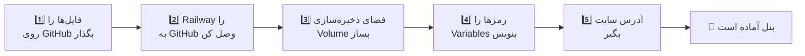

<p align="center">
  
</p>

<p align="center">
  
  
  
  
</p>

<div dir="rtl">

# ✨ پنل کلاس

یک سایت برای **مدیریت کلاس**: استاد حضور و غیاب، نمره، کوییز و تکلیف را مدیریت می‌کند و دانش‌آموزها با **مرورگر** یا **اپ اندروید** وارد می‌شوند.

> 🎯 این راهنما برای کسی نوشته شده که **هیچ تجربه‌ای ندارد**. فقط قدم‌ها را به‌ترتیب انجام بدهید.

| 🎓 استاد | 📱 دانش‌آموز |
|---|---|
| حضور و غیاب و نمره | ورود با نام کاربری و رمز |
| ساخت کوییز و نظرسنجی | شرکت در کوییز |
| تکلیف و اطلاعیه | ارسال تکلیف و پیام |
| چاپ کارنامه و پشتیبان‌گیری | ۷ تم رنگی، روشن و تیره |

---

> 🤖 **ربات تلگرام، ساخت اپ از تلگرام و تازه‌ها:** فایل [README-BOT.md](README-BOT.md) را ببینید.

## 🧰 قبل از شروع، این‌ها را آماده کنید

1. یک حساب رایگان در **[github.com](https://github.com)** (جایی که فایل‌های پروژه را می‌گذاریم)
2. یک حساب در **[railway.com](https://railway.com)** (جایی که سایت اجرا می‌شود؛ می‌توانید با حساب GitHub وارد شوید)
3. همین پروژه که zip شده؛ **اول آن را Extract (باز) کنید.**

## 🗺️ نقشه‌ی کار

</div>



<div dir="rtl">

---

# 🚀 بخش اول: راه‌اندازی سایت

## قدم ۱: فایل‌ها را روی GitHub بگذارید

> 💡 «مخزن» (Repository) یعنی یک پوشه‌ی آنلاین برای نگه‌داری فایل‌ها.

1. در GitHub بالا سمت راست روی **+** و بعد **New repository** بزنید.
2. یک اسم بنویسید (مثلاً `class-panel`) و **Create repository** را بزنید.
3. روی لینک **uploading an existing file** کلیک کنید.
4. **همه‌ی فایل‌ها و پوشه‌های داخل** پوشه‌ی باز‌شده را بکشید و رها کنید.
   ⚠️ خودِ پوشه را نه؛ **محتوای داخلش** را (باید `Dockerfile`، پوشه‌ی `site` و … را ببینید).
5. پایین صفحه روی **Commit changes** بزنید.

**✅ یک بررسی مهم:** داخل پوشه‌ی `site` در GitHub بروید و ببینید فایلی به اسم **`.htaccess`** هست یا نه. اگر نبود: **Add file ← Create new file**، اسم را `site/.htaccess` بنویسید، محتوای فایل را از کامپیوتر خودتان کپی و Paste کنید و Commit کنید.

## قدم ۲: Railway را وصل کنید

1. در [railway.com](https://railway.com) روی **New Project** بزنید.
2. **Deploy from GitHub repo** را انتخاب کنید.
3. مخزنی که ساختید را انتخاب کنید.
4. Railway خودش شروع به ساخت می‌کند (۲ تا ۴ دقیقه). منتظر بمانید.

> ⚠️ اگر در همین مرحله «Crashed» یا خطا دیدید نگران نباشید؛ هنوز متغیرها و Volume را نساخته‌ایم. ادامه بدهید.

## قدم ۳: Volume بسازید (خیلی مهم!)

> 💡 **Volume** مثل یک هارد دیسک برای سایت است. بدون آن، هر بار سایت دوباره ساخته شود **همه‌ی اطلاعات کلاس پاک می‌شود.**

1. روی مربع سرویس (در صفحه‌ی پروژه) **کلیک راست** کنید ← **Attach Volume**.
   (یا کلیدهای `Ctrl+K` را بزنید و بنویسید `volume`.)
2. در قسمت **Mount path** دقیقاً این را بنویسید:

</div>

```
/data
```

<div dir="rtl">

3. تأیید کنید.

## قدم ۴: رمزها را بنویسید (Variables)

1. روی سرویس کلیک کنید ← تب **Variables**.
2. روی **Raw Editor** بزنید و این متن را Paste کنید:

</div>

```
ADMIN_USER=teacher
ADMIN_PASS=یک-رمز-قوی-اینجا-بنویس
SESSION_SECRET=یک-متن-تصادفی-طولانی-مثلا-۴۰-حرف-اینجا-بنویس
DATA_DIR=/data
PORT=8080
```

<div dir="rtl">

3. **سه مقدار اول را عوض کنید:**

| متغیر | یعنی چی؟ | چی بنویسم؟ |
|---|---|---|
| `ADMIN_USER` | نام کاربری استاد | هر چه دوست دارید (انگلیسی) |
| `ADMIN_PASS` | رمز ورود استاد | رمز قوی و طولانی، **حتماً عوضش کنید** |
| `SESSION_SECRET` | کلید امنیتی | یک متن بی‌معنی و طولانی (حداقل ۳۰ حرف انگلیسی و عدد) |
| `DATA_DIR` | جای ذخیره‌ی اطلاعات | همان `/data` بماند |
| `PORT` | درگاه سایت | همان `8080` بماند |

4. روی **Update Variables** بزنید. Railway خودش دوباره سایت را می‌سازد.

## قدم ۵: آدرس سایت را بگیرید

1. سرویس ← **Settings** ← **Networking**.
2. روی **Generate Domain** بزنید.
3. اگر پرسید «کدام پورت؟» بنویسید **`8080`**.
4. یک آدرس مثل `https://xxxx.up.railway.app` می‌گیرید. 🎉

## قدم ۶: وارد شوید

| کی؟ | آدرس |
|---|---|
| 👩‍🏫 استاد | `https://آدرس-شما/` |
| 🧑‍🎓 دانش‌آموز | `https://آدرس-شما/app` |

استاد با `ADMIN_USER` و `ADMIN_PASS` وارد می‌شود. نام کاربری و رمز دانش‌آموزها را از **«دانش‌آموزان ← جدول حساب‌ها»** می‌سازید و «کارت ورود» را چاپ می‌کنید.

### ✅ چک‌لیست بعد از راه‌اندازی

- [ ] با رمز استاد وارد شدم
- [ ] از «پشتیبان‌گیری» یک نسخه دانلود کردم و روی گوشی/کامپیوترم نگه داشتم
- [ ] نام کاربری و رمز دانش‌آموزها را ساختم

---

# 📱 بخش دوم: ساخت اپ اندروید (APK)

> 💡 اپ فقط صفحه‌ی `/app` سایت را داخل یک برنامه نشان می‌دهد. ساختنش **رایگان** است و روی کامپیوتر خودتان چیزی نصب نمی‌کنید؛ GitHub برایتان می‌سازد.
> ⚠️ اول **بخش اول** را کامل کنید تا آدرس سایت را داشته باشید.

## قدم ۱: آدرس سایت را داخل اپ بنویسید

1. در GitHub پوشه‌ها را به‌ترتیب باز کنید:
   `android` ← `app` ← `src` ← `main` ← `res` ← `values`
2. روی فایل **`strings.xml`** کلیک کنید و بالای آن آیکون **مداد ✏️** را بزنید.
3. این خط را پیدا کنید:

</div>

```xml
<string name="default_server"></string>
```

<div dir="rtl">

4. آدرس سایت را **وسط** بنویسید (**بدون `/app`** و بدون `/` آخر):

</div>

```xml
<string name="default_server">https://xxxx.up.railway.app</string>
```

<div dir="rtl">

5. **Commit changes** را دو بار بزنید (بالا و داخل پنجره‌ی باز‌شده).

## قدم ۲: ساخت را شروع کنید

1. بالای مخزن روی تب **Actions** بزنید.
2. اگر دکمه‌ی سبز *I understand my workflows…* بود، آن را بزنید.
3. سمت چپ **Build APK** را انتخاب کنید.
4. سمت راست **Run workflow** (دو بار) را بزنید.

> 💡 بعد از قدم ۱ ممکن است ساخت خودش شروع شده باشد (دایره‌ی زرد 🟡). در این صورت دکمه‌ای نزنید.

## قدم ۳: صبر کنید

۳ تا ۶ دقیقه صبر کنید و صفحه را تازه کنید. وقتی دایره‌ی زرد 🟡 به **تیک سبز ✅** تبدیل شد، آماده است.

## قدم ۴: فایل را بردارید

1. روی ردیف تیک‌سبز کلیک کنید.
2. تا **پایین صفحه** بروید؛ بخش **Artifacts**.
3. روی **`ClassApp-APK`** بزنید تا یک zip دانلود شود.
4. zip را باز کنید؛ داخلش فایل **`app-debug.apk`** است. این همان اپ است. 🎉

## قدم ۵: به دانش‌آموزها بدهید

1. فایل را در گروه کلاس (تلگرام و …) بفرستید.
2. دانش‌آموز روی فایل می‌زند. اگر اندروید گفت «نصب مجاز نیست»، **Settings ← اجازه‌ی نصب از منابع ناشناس** را روشن کند.
3. اگر Play Protect هشدار داد: **Install anyway**. (طبیعی است، چون اپ در Play Store نیست.)
4. با نام کاربری و رمزی که استاد داده وارد شود.

> 🗂️ فایل داخل Artifacts بعد از ۳۰ روز پاک می‌شود؛ APK را جایی ذخیره کنید.
> 🌐 فقط اگر **آدرس سایت عوض شد**، APK را دوباره بسازید. تغییرات دیگر سایت بدون APK جدید داخل اپ دیده می‌شود.

---

# 🔄 به‌روزرسانی سایت

فایل جدید را روی همان مخزن GitHub آپلود کنید (روی فایل قبلی)؛ Railway خودش دوباره می‌سازد. اطلاعات کلاس پاک نمی‌شود چون روی Volume است.

---

# 🧩 اگر مشکلی پیش آمد

> 🔎 **اولین کار همیشه:** در Railway روی سرویس ← تب **Deployments** ← روی آخرین ردیف **View logs** بزنید. دلیل مشکل معمولاً همان‌جا نوشته شده است.
> ✅ لاگ سالم، این جمله را دارد: `Class Panel listening on :8080`

<details>
<summary><b>❌ لاگ می‌گوید «More than one MPM loaded» و سایت مدام Crash می‌کند</b></summary>

در نسخه‌ی جدید این مشکل حل شده است. مطمئن شوید فایل‌های `Dockerfile` و `docker/entrypoint.sh` را از نسخه‌ی جدید آپلود کرده‌اید. در لاگ باید بخش «Enabled MPM modules» فقط `mpm_prefork` را نشان بدهد. اگر باز خطا بود، تمام لاگ را برای پشتیبان بفرستید.
</details>

<details>
<summary><b>🌐 صفحه‌ی «Application failed to respond» یا خطای ۵۰۲</b></summary>

۱. در Variables مطمئن شوید `PORT=8080` هست.
۲. در Settings ← Networking، دامنه را پاک کنید و دوباره با پورت **8080** بسازید.
۳. لاگ را بررسی کنید.
</details>

<details>
<summary><b>💾 بعد از هر به‌روزرسانی اطلاعاتم پاک می‌شود</b></summary>

Volume وصل نیست یا Mount path دقیقاً `/data` نیست. قدم ۳ را دوباره بررسی کنید. در لاگ اگر `is not a mounted Volume` دیدید، همین مشکل است.
</details>

<details>
<summary><b>🔑 رمز ورود کار نمی‌کند</b></summary>

اگر یک‌بار رمز را از داخل پنل عوض کرده باشید، رمز جدید ذخیره می‌شود و `ADMIN_PASS` دیگر ملاک نیست. همان رمز جدید را وارد کنید. بعد از ۵ بار اشتباه، ۱۵ دقیقه ورود قفل می‌شود.
</details>

<details>
<summary><b>⚠️ پنل می‌گوید «رمز ضعیف است»</b></summary>

یعنی `ADMIN_PASS` را در Variables نساخته‌اید یا ساده است. یک رمز قوی‌تر بگذارید.
</details>

<details>
<summary><b>🔍 در Actions گزینه‌ی Build APK یا دکمه‌ی Run workflow را نمی‌بینم</b></summary>

فایل `.github/workflows/build-apk.yml` باید در **ریشه‌ی مخزن** باشد (کنار `Dockerfile`). پوشه‌هایی که با نقطه شروع می‌شوند گاهی موقع آپلود جا می‌مانند؛ با **Add file ← Create new file** و نوشتن مسیر کامل، آن را بسازید و محتوا را Paste کنید.
</details>

<details>
<summary><b>❌ ساخت APK قرمز شد</b></summary>

روی اجرای قرمز کلیک کنید، روی مرحله‌ی قرمز بزنید و متن خطا را برای پشتیبان بفرستید.
</details>

<details>
<summary><b>🌐 اپ می‌گوید «اتصال برقرار نیست»</b></summary>

آدرس باید با `https://` شروع شود و **بدون `/app`** باشد. سایت را در مرورگر گوشی باز کنید تا مطمئن شوید بالاست. از صفحه‌ی خطا می‌توانید «تغییر آدرس سرور» را بزنید.
</details>

<details>
<summary><b>📦 انتقال اطلاعات از هاست قبلی (cPanel)</b></summary>

در پنل قدیمی «پشتیبان‌گیری» بگیرید و در پنل جدید «بازیابی» کنید. راهنمای هاست معمولی: [docs/cpanel-fa.md](docs/cpanel-fa.md)
</details>

<details>
<summary><b>💻 برای حرفه‌ای‌ها: اجرا روی کامپیوتر خودتان</b></summary>

</div>

```bash
docker build -t class-panel .
docker run --rm -p 8080:8080 -e PORT=8080 \
  -e ADMIN_USER=teacher -e ADMIN_PASS=MyStrongPass123 \
  -e SESSION_SECRET=$(openssl rand -hex 32) \
  -v "$PWD/data:/data" class-panel
# باز کنید: http://localhost:8080
```

<div dir="rtl">

</details>

---

# 📖 واژه‌نامه

| کلمه | یعنی |
|---|---|
| **GitHub** | سایتی برای نگه‌داری فایل‌های پروژه |
| **Repository (مخزن)** | پوشه‌ی آنلاین پروژه در GitHub |
| **Railway** | سرویسی که سایت شما را روی اینترنت اجرا می‌کند |
| **Deploy (دیپلوی)** | ساخت و اجرای سایت روی Railway |
| **Volume** | هارد دیسک سایت؛ اطلاعات کلاس اینجا می‌ماند |
| **Variables** | تنظیمات و رمزهای سایت |
| **Domain (دامنه)** | آدرس سایت، مثل `xxxx.up.railway.app` |
| **APK** | فایل نصب اپ اندروید |
| **Commit** | ذخیره‌کردن تغییر در GitHub |

# 🔐 امنیت

- رمزها فقط در Variables هستند، نه داخل فایل‌ها. **رمزتان را هیچ‌جا منتشر نکنید.**
- بعد از ۵ تلاش اشتباه، ورود ۱۵ دقیقه قفل می‌شود.
- فایل‌های تنظیمات و اطلاعات از بیرون قابل دانلود نیستند.

</div>

<p align="center"><sub>ساخته‌شده برای کلاس طراحی سایت · هنرستان خوارزمی 💜</sub></p>
